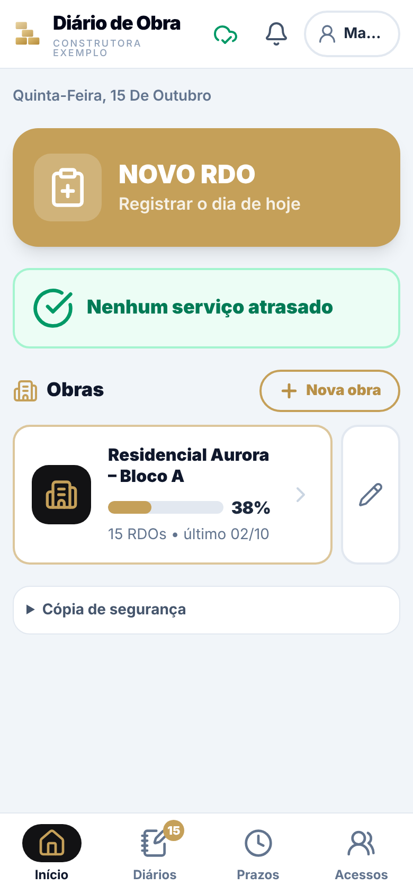
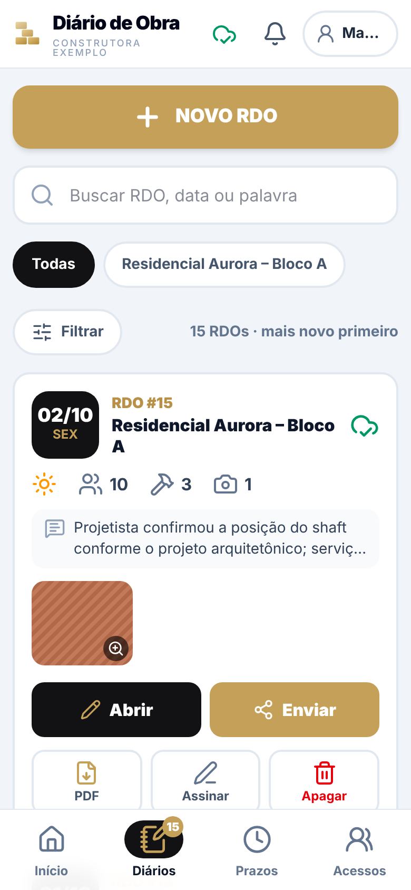
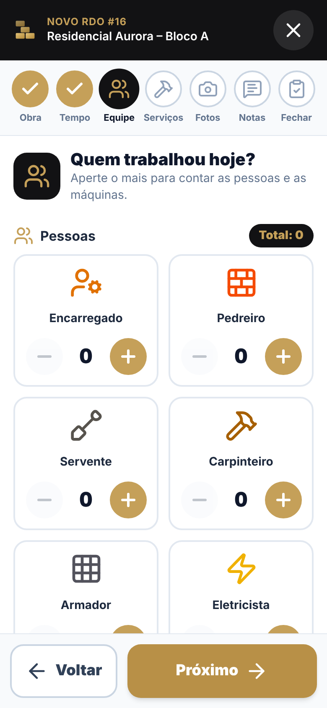
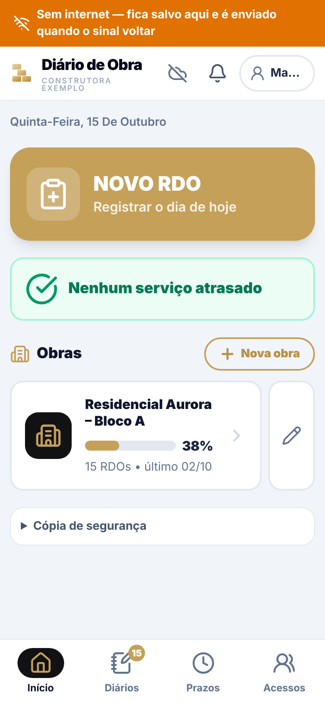
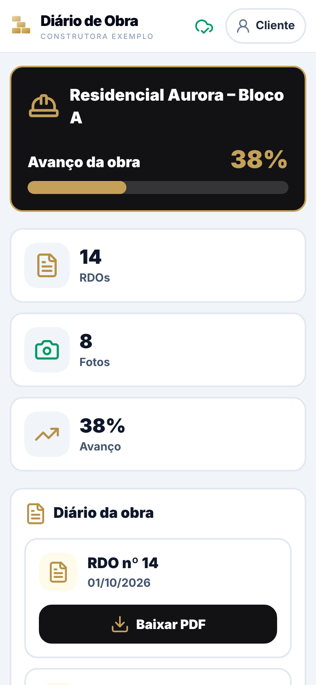

# Diário de Obra (RDO)

Aplicativo web para o **Relatório Diário de Obra**, pensado para o mestre de obras: ícones grandes, pouco texto,
abre e registra sem sinal e guarda tudo na nuvem com **login por função e restrição por obra**.

> Projeto de demonstração. A obra que acompanha o repositório ("Residencial Aurora – Bloco A"), as pessoas e as
> empresas citadas são **fictícias**. Nenhum dado real de cliente faz parte deste código (veja "Dados reais").

## O que faz

- Registro do RDO em passos curtos: clima, equipe, máquinas, serviços com andamento, notas, ocorrências, segurança.
- Fotos com legenda e tipo, comprimidas no aparelho; assinatura digital; PDF do RDO.
- **Offline primeiro:** o aparelho guarda uma cópia local (localStorage + IndexedDB) e sincroniza quando há sinal.
- **Acesso por função**, aplicado no servidor (esconder botões na tela é só conforto):

| Função | Vê | Edita |
|---|---|---|
| **Coordenador** | todas as obras | tudo: obras, RDOs, acessos |
| **Engenheiro responsável** | só as obras liberadas para ele | RDOs e dados dessas obras (não cria nem apaga obra) |
| **Cliente** | só as obras liberadas para ele; nunca vê rascunhos | nada (somente consulta) |

## Telas

Capturas reais do app rodando localmente (Chromium, 390×844) com a obra fictícia. Exemplo de PDF gerado: [docs/exemplo-rdo.pdf](docs/exemplo-rdo.pdf).

| Início | Diários | Formulário (equipe) |
|---|---|---|
|  |  |  |

| Sem internet (recarregado offline) | Visão do cliente (sem rascunhos) |
|---|---|
|  |  |

## Arquitetura

```
Celular / navegador (React 19 + Vite + Tailwind, PWA, jsPDF)
        │  HTTPS, cookie de sessão HttpOnly (mesmo endereço do app)
        ▼
Cloudflare Worker  (worker/)  ── /api/* ──►  D1 (SQLite): usuários, obras, RDOs, sessões
        │                                     R2 (opcional): fotos
        └── arquivos estáticos do app (dist/)
```

Sincronização (`src/services/cloudSync.ts`): envia o que ficou pendente e traz o que a pessoa pode ver. Se dois lados
editaram o mesmo RDO, **vale a edição mais recente** (limitação conhecida, veja abaixo). Apagar também sincroniza.

## Rodar no seu computador (sem conta na Cloudflare)

Requisitos: Node 22 ou mais novo.

```bash
npm install --legacy-peer-deps
npm run build
npx wrangler d1 migrations apply diario-de-obra --local
echo "SETUP_CODE=uma-frase-longa-e-aleatoria" > .dev.vars      # fica fora do git
npx wrangler dev --local                                        # app + API em http://127.0.0.1:8787
```

Abra o endereço: na primeira vez aparece **Primeiro acesso**. Informe o `SETUP_CODE`, seu nome, e-mail e uma senha
(mínimo de 10 caracteres). Esse é o coordenador.

> `npm run dev` (Vite) sozinho serve só a tela, sem a API: o login não funciona. Use `wrangler dev`.

### Carregar a obra fictícia

Com o `wrangler dev` rodando e o coordenador criado:

```bash
SEED_EMAIL=seu@email.com SEED_PASSWORD='sua-senha' node scripts/seed-demo.mjs --url http://127.0.0.1:8787 --users
```

Cria a obra, 15 RDOs (14/09 a 02/10/2026, o último como rascunho) e 9 fotos de exemplo pela própria API.
Com `--users` cria também um engenheiro e um cliente de demonstração (as senhas aparecem uma única vez no terminal)
para você ver as três funções. Pode rodar de novo: RDOs já editados no app não são sobrescritos.

## Publicar com o seu banco de dados (Cloudflare)

Tudo abaixo roda na **sua** conta; nada aponta para conta de terceiros. O plano gratuito costuma bastar para uso
pequeno, mas confira os limites atuais na Cloudflare, principalmente se for ligar o R2.

1. Entre na conta: `npx wrangler login`.
2. Crie o banco: `npx wrangler d1 create diario-de-obra`. Copie o `database_id` impresso para o `wrangler.toml`
   (substitua `COLE-AQUI-O-DATABASE-ID`).
3. Crie as tabelas: `npx wrangler d1 migrations apply diario-de-obra --remote`.
4. Defina o código do primeiro acesso: `npx wrangler secret put SETUP_CODE` (use uma frase longa e aleatória).
5. Compile e publique: `npm run build && npx wrangler deploy`.
6. Abra o endereço `*.workers.dev` mostrado no final, faça o **Primeiro acesso** e crie os demais acessos na aba
   **Acessos**. Depois disso o código de instalação deixa de ter efeito.

Atualizações: `npm run build && npx wrangler deploy`. Mudanças no banco entram como **novos** arquivos em
`worker/migrations/` (`npx wrangler d1 migrations apply diario-de-obra --remote`); nunca edite uma migração já aplicada.

### Fotos no R2 (opcional, recomendado em produção)

Sem R2 as fotos ficam no próprio D1 (funciona, mas o banco cresce rápido). Com R2, a imagem vai para um bucket e o D1
guarda só quem é dono dela. O código suporta os dois modos; fotos antigas no D1 continuam abrindo.

1. No painel da Cloudflare: **R2 Object Storage → Enable R2** (pode pedir cartão).
2. `npx wrangler r2 bucket create diario-de-obra-fotos`
3. No `wrangler.toml`, remova o `#` do bloco `[[r2_buckets]]`.
4. `npm run build && npx wrangler deploy`.

### Usar com a marca da sua empresa

- Nome e rodapé do PDF: `src/brand.ts`.
- Logo da tela: `src/components/AppLogo.tsx`. Ícone do app: `public/icon.svg` e os PNGs de `public/`.
- Textos do `index.html` e `public/manifest.webmanifest`.

## Testes

```bash
npm test         # testes de API e regras de acesso (node:test + SQLite em memória, sem rede)
npm run lint     # tsc do app e do worker
```

Os testes executam o Worker de verdade contra um D1 simulado sobre o SQLite do Node, aplicando as migrações reais.
Cobrem: instalação, login e limite de tentativas, sessões, CSRF, matriz de permissões (coordenador, engenheiro,
cliente), isolamento entre obras (sync e fotos), rascunhos ocultos para o cliente, validação de entrada, conflitos de
edição e a carga da obra fictícia. **Não cobrem** a interface nem o modo offline do navegador.

## Segurança

Resumo em [SECURITY.md](SECURITY.md): senhas com PBKDF2-SHA256, sessões com token aleatório guardado só como hash,
cookie `HttpOnly; SameSite=Strict; Secure`, checagem de origem em escritas, limite de tentativas de login, CSP
restritiva, autorização sempre no servidor. O mesmo arquivo lista as **limitações conhecidas**.

## Relatório quinzenal com IA (em andamento)

Plano e régua de avaliação em [docs/PLANO-IA.md](docs/PLANO-IA.md). Hoje existe só a parte de medição
(`node relatorio-ia/avaliar.mjs`, com dados fictícios); a geração por modelo ainda não foi ligada ao app.

## Limitações conhecidas

- **Sincronização por "última edição vence":** dois editores offline no mesmo RDO podem perder alterações de um deles.
- Cada instalação serve **uma** organização (não há separação entre empresas no mesmo banco).
- Fotos trafegam como data URL em JSON (limite de ~1,5 milhão de caracteres cada); não serve para fotos em
  resolução original.
- Sem testes automatizados de interface e do modo offline. Verificação manual feita uma vez em Chromium: login, listas, PDF, recarga sem rede com service worker ativo, e visão do cliente (14 de 15 RDOs; o rascunho fica oculto). Não testado em celular real nem em Safari/iOS.
- Projeto desenvolvido com assistência de IA (Claude Code); requisitos, decisões e revisão são do autor.

## Dados reais

Nunca coloque dados de obra reais (RDOs, fotos, nomes de clientes) neste repositório. As pastas `dados-reais/` e
`importacao/` estão no `.gitignore` para guardar arquivos locais. Se for usar com dados de uma empresa, publique a
instalação na infraestrutura **dela** ou com autorização por escrito.

## Estrutura

```
src/           app React (telas, serviços, PDF, sincronização)
worker/        API (Cloudflare Worker): auth, rotas, validação, migrações D1
demo/          obra fictícia usada pelo seed e pelo exemplo de IA
scripts/       seed-demo.mjs e utilitários
tests/         testes de API e regras de acesso
relatorio-ia/  baseline, avaliador e prompt do relatório com IA (exemplo fictício)
docs/          plano do relatório com IA
```
